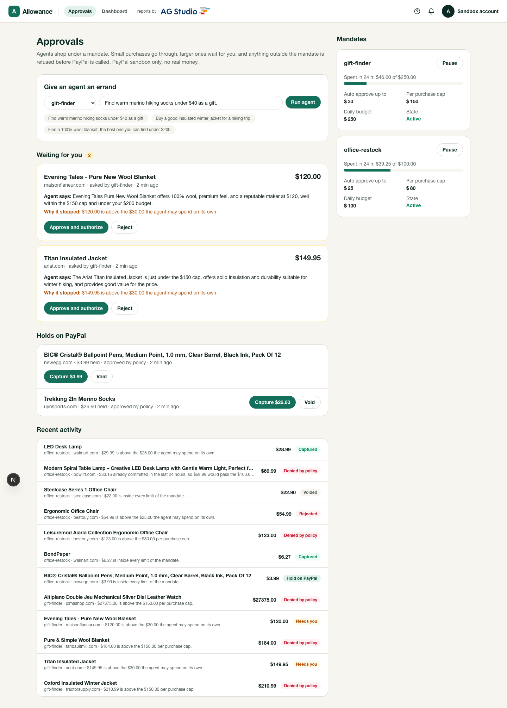
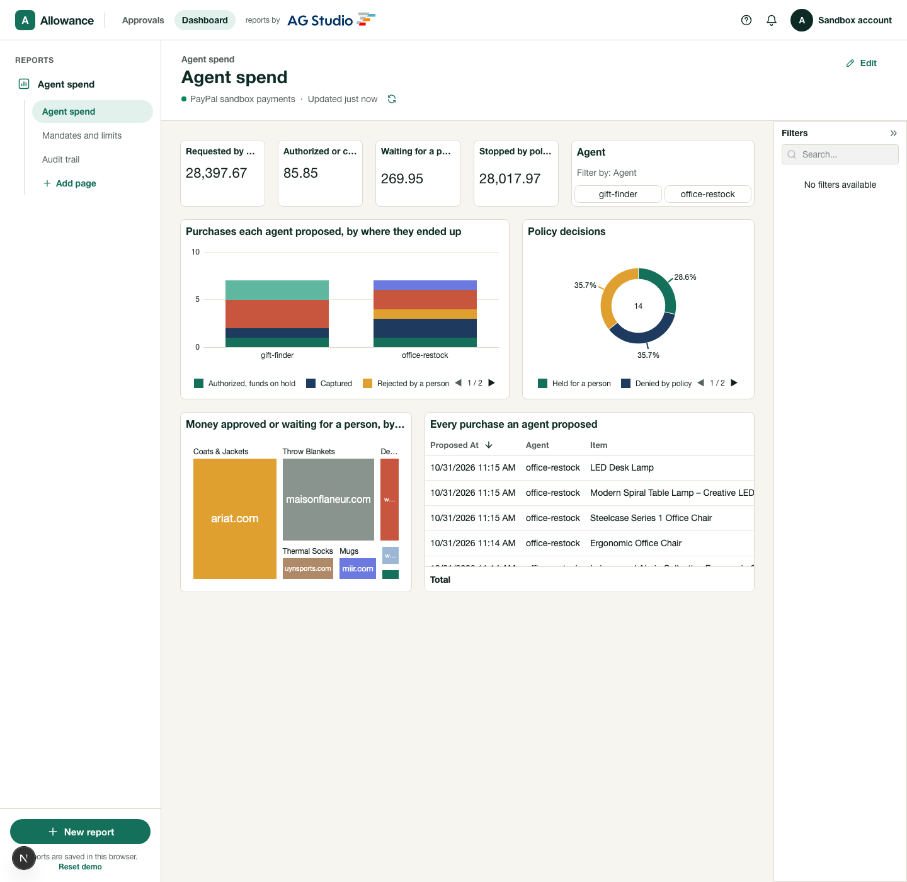
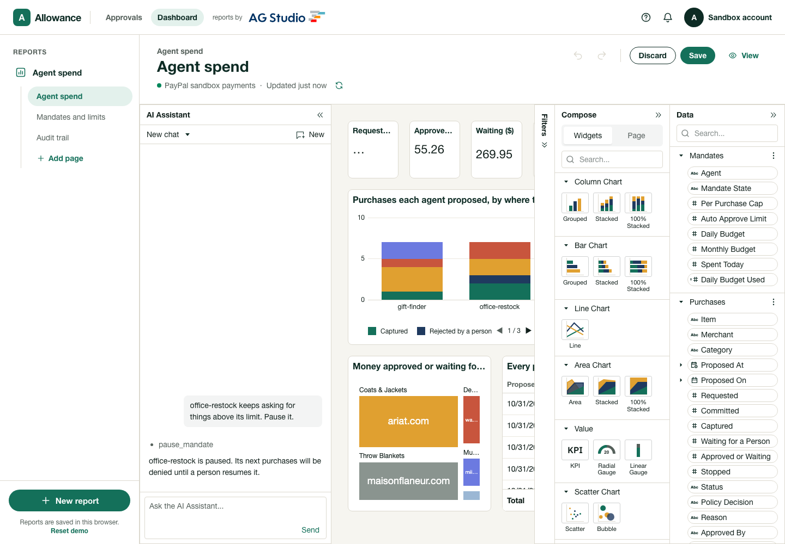

# Allowance

Spending mandates and human approval for AI shopping agents, on the PayPal sandbox.

An AI agent that can buy things needs limits that the model cannot talk its way around. Allowance gives each agent a
**mandate** (a per purchase cap, an amount it may spend alone, a daily budget) and puts a policy engine between the
agent and PayPal. Small purchases go through, larger ones wait for a person, and anything outside the mandate is
refused before PayPal is called. An AG Studio dashboard shows where the money went and why, and an agent inside that
dashboard can tighten the limits when asked.

Built for the PayPal AI Hackathon. PayPal sandbox only, no real money moves.

| | |
|---|---|
| Hosted demo | https://allowance-paypal-agents.vercel.app (state is kept in a private Vercel Blob) |
| Video | `demo/allowance-demo.mp4` (2:28), also linked on the Devpost submission |
| License | MIT |



## How a purchase flows

```
errand ──> agent (Fireworks gpt-oss-120b, tool calling)
             ├─ search_products ──> Channel3 /v1/search  (real offers, one per retailer)
             └─ propose_purchase ─> server looks the offer up in those results
                                      │  price and merchant come from Channel3, never from the model
                                      ▼
                              policy engine (lib/allowance/policy.ts, pure functions)
                  ┌───────────────────┼─────────────────────┐
              deny (no PayPal call)   hold for a person     approve
                                      │ person approves       │
                                      ▼                       ▼
                         PayPal Orders v2, intent=AUTHORIZE  ──> funds on hold
                                      │
                       person captures (full or lower final price) or voids
                                      │
                         PayPal webhooks reconcile captures and voids
```

Money only moves at capture. Every step is written to an audit log that the dashboard reads.

## What it uses

**PayPal (sandbox REST API, plain fetch, no SDK)**
- Orders v2 with `intent=AUTHORIZE`, then authorize, capture and void (`lib/allowance/paypal-orders.ts`).
- Capture can be for less than the authorization, which is how an estimate is settled at the final price.
- `PayPal-Request-Id` on every write, so a retry cannot double charge.
- Webhooks: signature checked with PayPal's `verify-webhook-signature`, then `PAYMENT.AUTHORIZATION.VOIDED` and
  `PAYMENT.CAPTURE.COMPLETED` reconcile the records, idempotently (`lib/allowance/webhook.ts`).
- Funding: by default the order is funded by a PayPal sandbox test card in one call, so no buyer has to log in
  (`PAYPAL_FUNDING=card`). The wallet path is also implemented (`PAYPAL_FUNDING=wallet`): the order stops at the PayPal
  approval URL, and `/api/paypal/return` authorizes it after the buyer returns. See "What is and is not demonstrated".

**AI**
- The shopping agent runs on `gpt-oss-120b` served by Fireworks, with tool calling (`lib/allowance/agent.ts`).
  It never sees the mandate limits and cannot set a price. A proposal for an offer it did not find is rejected.
- The AG Studio assistant uses the same model through Fireworks' Responses API (`app/api/ai/responses`).
- Claude Code (Anthropic) was used to write and test this repository.

**AG Grid / AG Studio** (primary sponsor tool)
- The dashboard is an AG Studio report over three tables (mandates, purchases, audit events) with relationships, a
  calendar, calculated measures (approved by policy share, stopped rate, daily budget used) and three pages:
  agent spend, mandates and limits, audit trail (`app/dashboard/studio`).
- A custom **treasurer agent** is added to Studio's own agent team through the Studio Agent Framework
  (`app/dashboard/studio/ai.ts`). It reads data with Studio's query tool, hands chart and page edits to the built-in
  `data`, `page`, `planning` and `widget` agents, and has four tools of its own: `list_mandates`, `pause_mandate`,
  `resume_mandate`, `set_mandate_limit`. Tightening a limit applies at once. Loosening one (raising a limit, resuming
  an agent) opens a browser confirmation that a person must accept, so the model cannot talk its way past it.
  To try it, open the dashboard, choose Edit, open the AI Assistant panel and ask it to pause an agent.
- A custom theme: tokens in `app/globals.css` feed the shell, Studio, grids and charts.




**Channel3**
- Every product the agent can propose comes from Channel3's `/v1/search` (`lib/allowance/channel3.ts`), one candidate
  per in-stock retailer offer. Remove the key and the agent has nothing to buy.

## Run it

Requires Node.js 20.9 or later and the keys in `env.example`.

```bash
npm install
cp env.example .env.local     # PayPal sandbox app, Channel3 key, Fireworks key, AG Studio trial licence
npm run dev                   # http://localhost:3000
node scripts/seed-demo.mjs http://localhost:3000   # optional: fill it with real agent runs
npm test                      # 32 tests, no network needed
npm run demo                  # one live agent run against Channel3, Fireworks and the PayPal sandbox
```

On macOS, if Next fails to load its native modules, run it with a signed Node such as Homebrew's and put it first on
`PATH`.

A fresh start loads `data/seed-state.json`, which holds real runs recorded from the sandbox. Set
`ALLOWANCE_SEED=off` for empty mandates instead. `ALLOWANCE_STATE_FILE` chooses where state is kept (default
`.data/state.json`).

To receive webhooks, deploy the app, register `https://<host>/api/paypal/webhook` for `PAYMENT.CAPTURE.COMPLETED` and
`PAYMENT.AUTHORIZATION.VOIDED` in the PayPal dashboard, and set `PAYPAL_WEBHOOK_ID`.

## Tests

`npm test` runs 32 tests with the model and PayPal mocked at the fetch boundary:
- policy engine: every rule, edge values (inclusive limits, exact budget), rolling windows, a lifecycle that cannot
  skip the human or the authorization;
- workflow: auto approval, denial that never reaches PayPal, hold then approve, reject, partial capture, void, budgets
  counting committed money but not voided money, pause taking effect on the next proposal, wallet funding;
- agent: cannot buy an offer it did not search for, cannot set its own price, is told when a purchase is held;
- webhooks: forged signature refused, a void done outside the app reconciled, duplicate capture events harmless.

## Ablation: what the policy engine stops

Same agent, model, errands and PayPal sandbox, once under the demo mandate and once with limits so wide they never
bind (`npm run ablation`, full table in [`docs/ablation.md`](docs/ablation.md)). Money authorized with no person
involved: **$53.98 guarded, $27,870.73 unguarded**. The unguarded agent authorized a $27,375.00 luxury watch and a
$262.73 jacket. The guarded agent had both denied, then proposed cheaper alternatives, one of which waited for a
person. Search results vary between runs, so exact items differ.

## Judging criteria

- **Technological implementation:** Orders v2 authorize, capture, void and verified webhooks against the sandbox; a
  tool calling agent grounded in live catalog data; a pure policy engine with tests; a custom agent inside AG Studio's
  agent framework.
- **Design:** one product with an approvals queue, mandate editor, audit trail and reports, not a script.
- **Potential impact:** anyone letting an AI agent spend money needs limits that are enforced outside the model, with a
  person in the loop for larger amounts and a record of every decision.
- **Innovation:** the approval and limit layer sits between the agent and the payment rail, and the dashboard agent can
  only tighten limits by itself.
- **Presentation:** the video shows an errand, a held purchase, a denial, a capture at a lower final price, and the
  treasurer agent pausing an agent.

## What is and is not demonstrated

- Demonstrated against the live PayPal sandbox: order creation with intent AUTHORIZE, authorization, full and partial
  capture, void.
- Funding in the demo is a PayPal sandbox test card, a stand in for a card an agent holds. A buyer approving at PayPal
  with a sandbox personal account (the wallet path) is implemented but was not exercised, because no sandbox buyer login
  was available.
- Webhooks: a real `PAYMENT.CAPTURE.COMPLETED` event from the sandbox was delivered to the hosted app, verified with
  PayPal's signature endpoint and recorded in the purchase's audit log. The handler logic is also covered by tests.
- PayPal's own agentic commerce products were not used: they are invite only.
- Hosted state lives in one JSON blob that handlers read before and write after each request. Two simultaneous writes
  would race (last one wins), which is fine for a demo and not for production. Local runs persist to `.data/state.json`.
- The AG Studio licence is a 45 day trial.

## Credits

Started from PayPal's open
[AG Grid boilerplate](https://github.com/paypaldev/hackathon-paypal-ag-grid-boilerplate) (Next.js app shell and the
AG Studio wiring). Everything under `lib/allowance`, `app/api`, `app/approvals.tsx`, the Studio data, report and agent
files, the tests and the scripts is new in this repository. The boilerplate's PayPal read-only pages (products, plans,
invoices, transactions, balances) were removed.
